# PetLens 🐾

## 长期宠物安全档案 + 风险决策助手

PetLens 面向真实的宠物家庭，把“我家宠物现在该怎么办？”从一次性的物品查询，重构成一条可解释、可修正、可回看的事件风险判断流程。

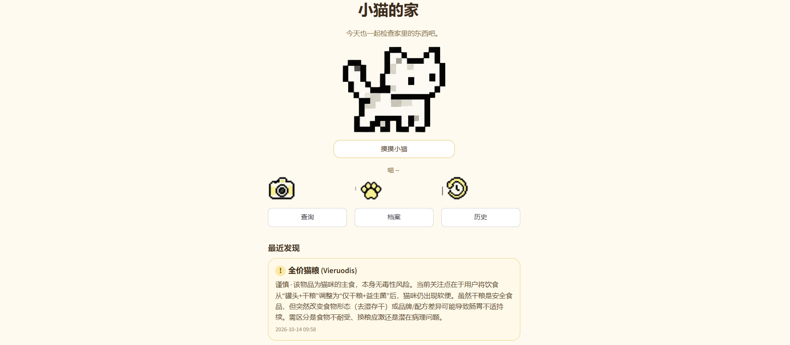


| 上下文选择界面1                      | 上下文选择界面2                      |
| ------------------------------------ | ------------------------------------ |
| 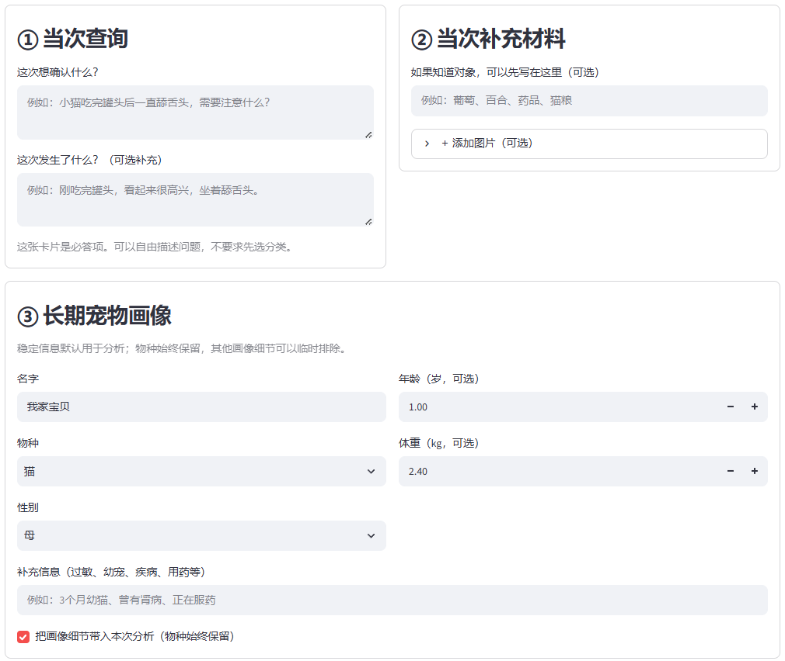 | 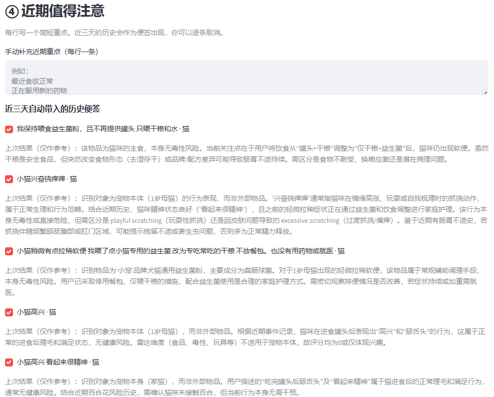 |


宠物主人遇到异常情况时，真正想确认的通常是：

> 这件事对我家宠物意味着什么？现在应该做什么？什么情况需要尽快联系专业人士？

PetLens 将一次宠物事件转化为一条可追踪的判断流程：

**事件描述 + 图片或文字材料 → 用户确认观察 → 宠物画像与近期事件 → 风险判断与行动建议 → 结果和依据留档**

物品识别只是输入材料，产品输出的是一条可解释、可修正、可回看的事件判断。


### 它与通用问答和宠物档案产品的区别

- **多模态、结构化输入：** 支持文字描述、图片上传和手机拍照；图片观察会先被标准化，并由用户确认是否进入本次分析。
- **上下文渐进式可控：** 简易模式降低使用门槛，允许系统自动选择相关近期信息；展开模式支持用户查看、编辑和选择上下文，并可在分析后回看实际采用的内容。
- **宠物画像参与判断：** 系统不仅处理“发生了什么”，还结合“这是哪只宠物、最近发生过什么”。
- **结果可追溯且能以相同的显式的方式进入上下文：** 保存结构化结论、证据关系、用户修正和本次上下文快照，之后可以回看当时为什么得到这个判断。

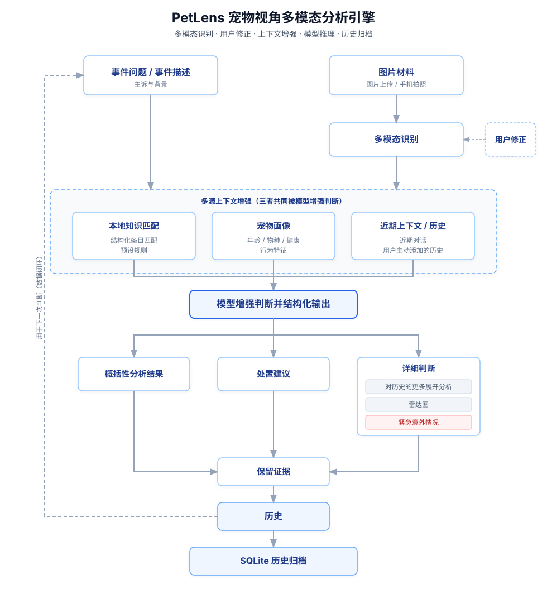

```
当前版本是一个可在 WSL2 本地运行的 MVP，关键路径自动化测试：44 项通过。
已完成：事件输入 → 多模态材料识别 → 上下文选择 → 结构化风险判断 → 历史回溯

PetLens 用于宠物事件的信息整理、风险提示和下一步建议，不能替代兽医诊断。若宠物已经误食、出现明显异常或情况快速恶化，请及时联系兽医。
```

---

## 为什么做这个产品

宠物家庭遇到的是一串需要连续判断的问题，这超出简单的  “是什么、能不能吃的范畴”  ：

- 这是什么？图片中的物品、包装或现场信息应该怎样标准化描述？
- 对**我家这只宠物**有什么关系？年龄、体重、物种、既往情况和性格是否会改变判断？
- 最近发生了什么？宠物当前状态、已经采取的措施和前几次事件是否需要一起考虑？
- 现在先观察什么、做什么，什么情况应该尽快联系专业人士？
- 过几天回看时，能不能知道当时用了哪些背景、为什么得到这个结论？

通用聊天助手可以回答宠物问题，但上下文通常隐藏在系统内部；单独的物品识别只能回答“它通常是什么”。


PetLens 的产品价值在于把这两件事连接起来，并把连接过程交给用户确认：

> **通用聊天 AI 知道养猫，但它不一定稳定地知道我的猫。PetLens 维护的是经过主人确认的长期档案，并明确展示每次判断采用了哪些事实。**

---

**PetLens 的差异是把每次的用以分析的具体上下文，用户都有机会自主选择判断，且分析结果又能再次显式作为下一次分析的可选上下文，由此形成，使用越多，可查看审阅的宠物个性化档案越完整，petlens 越懂你的宠物的持续正向反馈。**


## 当前版本运行证据：一次猫粮事件

以下截图来自当前版本的真实本地运行，展示从输入、识别、上下文选择到结果输出的完整链路。
**本案例表明了 PetLens 的个体化上下文分析能力：** 系统将“幼猫”这一长期画像，以及近期换粮、喂食益生菌等重要事件**明确进入分析环节**，对新出现的软便问题，给出结合个体背景的判断与行动建议。

同时，系统**明确展示**本次采用的上下文和判断依据，支持用户确认、修正与后续回看。

### 1. 当次查询

用户先提出当前想确认的问题，问题本身不被限制成固定模板。

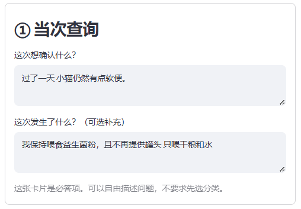

### 2. 当次补充材料

图片材料是可选的，进入分析前会作为单独卡片显示。

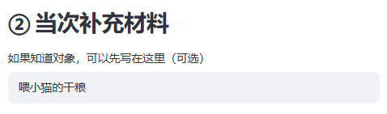

### 3. 图片材料

本例上传了一袋猫干粮。图片在这里是证据材料，不直接等同于最终健康结论。

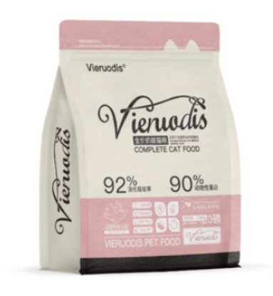

### 4. 识别与用户修正

视觉模型先给出标准名称、置信度、客观描述、可见文字和候选名称。用户可以修改名称，并决定是否把这条观察加入本次上下文。

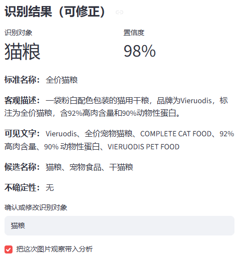

### 5. 近期状态

近期事件可以拆成简短、可编辑的状态便签，减少用户重复叙述。

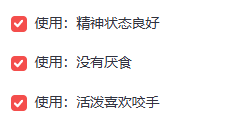

### 6. 本次实际使用的上下文

分析前可以展开查看当前模式、长期画像、图片观察和近期记录，确认系统准备依据哪些内容。

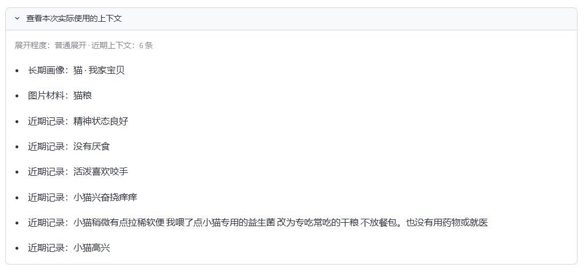

### 7. 面向人的概括判断与行动建议

结果页先给出可读的概括判断，再展示风险级别、证据等级和下一步行动。

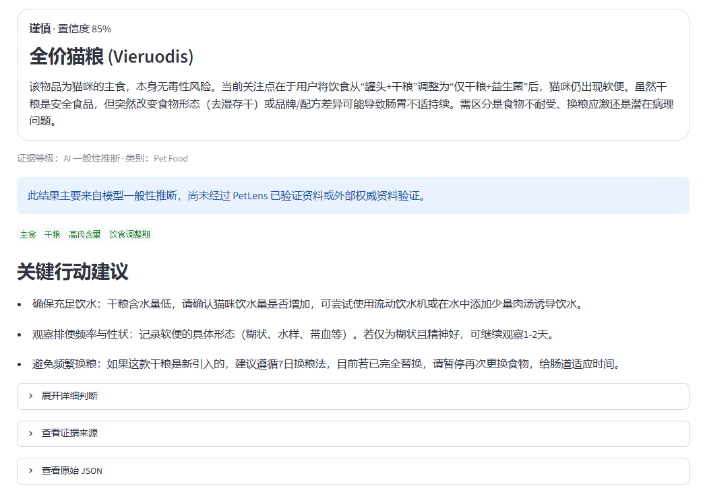

### 8. 结构化结论与雷达图

更详细的结果包含五维评分、解释和 claim-evidence 关系，便于回看、比较和后续导出。

当前五维评分用于辅助描述物品属性与潜在风险，属于尚未经过大样本校准的探索性指标，不代表医学意义上的风险概率或安全认证。


## 从“查物品”到“记录事件”的三次迭代

最初的假设是：用户拍下一件物品，系统告诉他能不能吃、是否危险。真正开始养猫并观察日常，查找社区经验后，我发现长期查询假设并不成立：同一个物品，放进不同的宠物、状态、剂量和已采取措施里，下一步建议可能完全不同。

| 版本 | 用户动作 | 系统回答 | 暴露出的局限 |
| --- | --- | --- | --- |
| **V1：物品查询** | 拍照或输入物品名称 | 这是什么、通常有什么风险 | 缺少事件背景，结论容易停留在通用知识 |
| **V2：事件查询** | 描述发生了什么、想确认什么，再附图片 | 针对这次情况给出风险与行动建议 | 仍需要长期了解“这是谁” |
| **V3：长期档案驱动** | 事件 + 图片材料 + 宠物画像 + 近期事件 | 在可见、可控的上下文中完成个性化判断，并保存历史 | 继续完善标签、来源检索和置信度校准 |

因此，当前版本不再把“识别一件物品”当成产品终点。物品识别是事件输入的一种材料；每一次分析都形成一条可追踪的事件记录。

---

## 产品位置与形态参照

下面的比较来自公开产品页面和实际试用中的产品形态观察，用来说明 PetLens 的设计取向，不构成完整的竞品功能评测。

| 产品形态 | 常见入口 | 上下文如何进入回答 | PetLens 的切入点 |
| --- | --- | --- | --- |
| 通用聊天助手 | 自由输入、上传图片 | 多数情况下由系统隐式选择 | 将上下文准备过程展示出来，让用户确认和修正 |
| 宠物语音或问答助手（例如 PawSight） | 语音提问、连续对话 | 以快速问答为主，过程较少被拆开 | 保留自然提问，同时把识别、上下文和分析阶段显式化 |
| 宠物档案、待办或事件管理产品（例如 Petto） | 建立宠物资料、记录事件和任务 | 长期信息更多用于管理和提醒 | 把档案直接接入当前风险判断，并展示本次实际采用的内容 |
| 宠物健康洞察产品（例如 Pettioe AI Pet Health） | 健康问题与宠物资料 | 侧重健康洞察输出 | 进一步加入图片证据、用户确认和可复盘的 claim-evidence 关系 |
| **PetLens** | 事件问题 + 可选图片/文字材料 | **问题、图片观察、长期画像、近期事件分层展示；用户可控制进入本次分析的内容** | **长期宠物安全档案与风险决策助手的结合** |

---

## 当前最短闭环

### 四类上下文卡片

| 卡片 | 作用 | 当前交互 |
| --- | --- | --- |
| **当次查询** | 当前想确认的核心问题，是分析必需输入 | 自由输入，必填 |
| **当次补充材料** | 图片、拍照或手动输入的对象和现场材料 | 先识别并标准化；用户可以修改名称，并决定是否纳入本次分析 |
| **长期宠物画像** | 名字、物种、年龄、体重、性别、既往情况和补充备注 | 作为稳定背景，可在详尽模式中编辑 |
| **近期事件** | 最近状态、已经采取的措施，以及近三天值得关注的历史 | 用户可以输入、勾选或取消；普通模式提供简洁入口 |

### 一次分析的路径

1. **描述事件**：填写“这次想确认什么”，可补充发生经过、症状和已经采取的措施。
2. **添加材料**：上传图片、调用手机拍照，或输入一个对象；系统输出标准名称、置信度、客观描述、可见文字、候选名称和不确定性。
3. **确认观察**：用户可以修正识别名称，也可以决定某条图片观察是否进入本次上下文。
4. **选择背景**：查看长期画像和近期事件；在详尽模式中逐条选择本次要使用的内容。
5. **召唤分析**：本地结构化知识先参与匹配，视觉观察、用户输入、画像和近期事件共同进入文本分析管线。
6. **保存结果**：输出风险等级、五维评分、证据关系、解释、行动建议和紧急信号，并保存事件、画像和本次上下文快照。

---

## 三档渐进式上下文控制

第一次使用时，用户不应该被迫填写一整套档案；但产品也不能为了“简单”而把上下文永远藏在后台。因此当前版本用同一个分析管线提供三档展开程度：

| 模式 | 页面显示 | 本次分析行为 |
| --- | --- | --- |
| **最简易** | 只显示必答问题 | 后台提供少量近期候选，由模型判断与当前问题的相关性；用户可以像使用普通助手一样直接开始 |
| **普通展开** | 问题、图片入口、近期重点入口 | 宠物画像自动保留，用户可以补充图片和简短近期背景 |
| **详尽展开** | 问题、图片、宠物画像、近期事件逐项展开 | 用户可以编辑画像，并逐条选择近期事件；长期历史当前以只读方式查看 |

滑块切换会同步显示或隐藏相关卡片，已经输入的内容会保留。分析结束后还可以展开“本次实际使用的上下文”，把系统真正采用的背景还给用户。

---

## 其他结果、证据与历史

### 结构化数据

结果由固定的数据模型校验，下面是字段关系的简化示意：

~~~json
{
  "risk_level": "谨慎",
  "confidence": 0.85,
  "scores": {
    "food": 78,
    "toxicity": 18,
    "toy": 6,
    "physical_hazard": 22,
    "interest": 12
  },
  "claims": [
    {
      "text": "当前更适合保持单一饮食并观察排便变化",
      "evidence_refs": ["user_event", "vision_observation"],
      "basis": "model_inference"
    }
  ],
  "actions": ["保持饮水", "按说明使用", "观察恶化信号"],
  "emergency_signs": ["持续加重", "明显精神沉郁", "拒食或脱水"]
}
~~~

图片观察、用户确认信息、本地知识条目和模型推断分别标记来源。PetLens 不把图片识别描述直接当成健康事实，也不把模型自评的置信度冒充成经过大样本校准的统计概率。

### 主要技术

| 层次 | 技术与职责 |
| --- | --- |
| 交互层 | **Python + Streamlit**：首页、事件输入、三档渐进展开、上下文预览和结果页 |
| 视觉识别 | **DashScope / Qwen3-VL**：识别物品、包装文字和可见客观事实 |
| 文本分析 | **Qwen3.7-Plus**：结合事件与上下文生成风险判断、解释和行动建议 |
| 知识与数据 | 本地结构化知识条目 + **SQLite**：支持物品匹配、事件历史和画像快照 |
| 数据契约 | **Pydantic**：约束视觉结果、宠物画像、风险结果和 claim-evidence 关系 |
| 服务与验证 | **Bash / WSL2** 管理本地服务，**pytest** 覆盖关键路径 |

---

## 运行与配置

推荐在 Windows 10/11 的 WSL2 中运行：

~~~bash
cd ~/code/petlens-mvp
./scripts/start.sh
./scripts/status.sh
~~~

浏览器打开：http://localhost:8501/

停止或重启服务：

~~~bash
./scripts/stop.sh
./scripts/restart.sh
./scripts/logs.sh
~~~

首次配置时复制 .env.example 为 .env，按需填写：

| 变量 | 用途 | 当前示例 |
| --- | --- | --- |
| DASHSCOPE_API_KEY | 阿里云百炼 API 密钥 | 留空 |
| DASHSCOPE_BASE_URL | OpenAI 兼容接口地址 | https://dashscope.aliyuncs.com/compatible-mode/v1 |
| DASHSCOPE_VISION_MODEL | 图片识别模型 | qwen3-vl-plus |
| DASHSCOPE_TEXT_MODEL | 文本分析模型 | qwen3.7-plus |

不要提交 .env、.streamlit/secrets.toml 或任何真实密钥。

---

## 测试与项目结构

~~~bash
.venv/bin/python -m pytest -q
~~~

当前版本本地验收结果：**44 passed**。

~~~text
PetLens/
├── app/
│   ├── models.py             # 画像、事件、风险结果与证据模型
│   ├── pipeline.py           # 本地匹配、上下文组装与分析管线
│   ├── providers/            # 视觉与文本模型适配层
│   ├── storage.py            # SQLite 事件历史与兼容读取
│   ├── knowledge.py          # 本地结构化知识匹配
│   └── ui/                   # 首页、画像、历史页面
├── data/                     # 本地结构化知识条目
├── docs/                     # 架构图、运行截图与数据库说明
├── examples/                 # 脱敏结构化结果示例
├── scripts/                  # WSL/Linux 服务管理脚本
├── tests/                   # 自动化测试
├── .env.example              # 环境变量模板
└── streamlit_app.py          # Streamlit 入口
~~~

---

## 当前边界与下一步

当前版本已经完成“事件输入 → 上下文选择 → 风险判断 → 历史回溯”的最短闭环，但仍有明确边界：

- 本地知识条目覆盖有限，未命中的问题仍可能依赖模型的一般性推断。
- 当前置信度尚未经过大规模真实样本校准，不能等同于统计意义上的准确概率。
- 长期历史目前主要用于查看和近期候选，尚未形成完整的标签化时间线。
- 经验贴、权威资料聚合检索、打印版报告和更细的管家式表达仍属于后续增强方向。
- 当前验证重点是本机和局域网运行，尚未提供公网部署。

后续产品演进会围绕三条线展开：

1. **让上下文更容易理解和修正**：把稳定事实、近期状态和可选历史逐步标签化，并保留用户纠错入口。
2. **让来源与“不知道”更诚实**：接入可引用的专业资料和真实经验来源，区分已知事实、模型推断和待确认信息。
3. **让判断更快、更稳**：由本地知识和规则先给出可用的初步判断，再让模型完成需要综合语境的部分，并持续校准置信度。

---

## 开发方式

本项目采用 AI-assisted development：Codex 辅助代码生成、重构与测试；项目负责人负责需求定义、产品机制设计、模型与工具选型、功能验收、异常反馈和迭代决策，并通过自动化测试与实际运行结果逐项验收。

项目仓库：[oanhnk2211-maker/petlens-mvp](https://github.com/oanhnk2211-maker/petlens-mvp)

